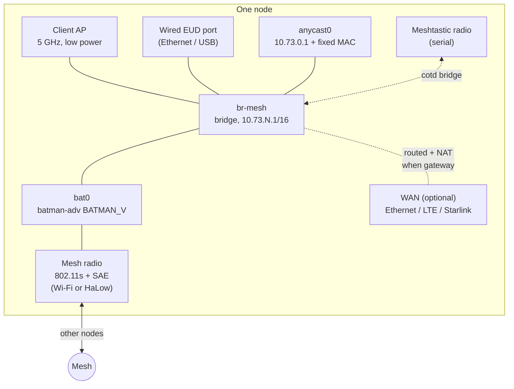

# Meridian Trellis — Architecture

*Meridian Systems. Status: design; M0–M3 built, M2–M4 lab-proven. Last updated 2026-11-04.*

This document describes what Meridian Trellis ("Trellis") is, how a node works, and why each
major decision was made. Rationale is kept short and marked **Why:**. Where a
decision leans on behaviour in batman-adv or another component, the source
is named so it can be re-checked. Sequencing is in [roadmap.md](roadmap.md).

---

## 1. What this is

An open-source tactical mesh radio system: a body-worn node, in the class of
an MPU5, that gives a team a self-forming encrypted IP network with first-class
ATAK support, opportunistic internet sharing, and a LoRa side-channel.

It ships two ways from one codebase:

- **Self-install** onto a supported Debian-family system.
- **Prebuilt images** for specific hardware.

## 2. Requirements

| ID | Requirement |
|---|---|
| R1 | ATAK works across the whole mesh with no EUD configuration beyond joining the node's Wi-Fi: multicast SA and chat, plus unicast to TAK Servers. |
| R2 | Any EUD or node can reach any other, and any service on them (TAK Server, web, files), with no internet gateway present. |
| R3 | Any node with a WAN uplink shares internet with the whole mesh, automatically. |
| R4 | When a gateway fails and another exists, new connections move to it within **5 s**, invisibly to EUDs. |
| R5 | Mesh links are authenticated and encrypted. |
| R6 | Supports standard Wi-Fi mesh radios and Wi-Fi HaLow (802.11ah). |
| R7 | *Optional* (since 2026-11-04): integrates Meshtastic LoRa radios over serial (and TCP for HAT radios). |
| R8 | Web UI and API for management and status. |
| R9 | Optimised for 1–50 nodes, typically one body-worn node per person with their phone attached. |
| R10 | Delivered as a self-installable package and as prebuilt images. |

**Non-goals (v1):** IPv6 for clients; keeping open TCP connections alive across
a gateway failover; meshes of hundreds of nodes; interoperability with
proprietary radios.

## 3. Design principles

1. **The EUD just works.** Join the node's Wi-Fi; nothing else to configure, on any node.
2. **Disconnected first.** Everything inside the mesh works with no WAN. Internet is a bonus.
3. **Airtime is the scarcest resource.** No periodic mesh-wide flooding beyond batman-adv's own routing messages; prefer unicast.
4. **Use the protocol's own mechanism before building one.** batman-adv already does gateway announcement, ARP caching, loop avoidance and efficient multicast.
5. **Reconcile, don't script.** One declarative config; a loop that converges the system to it, safe to rerun at any time.
6. **Own the kernel interface.** Configure through netlink rather than distro tooling, so one binary runs on every platform.
7. **Fail safe.** Never route through an unverified gateway; never lock the operator out.
8. **If it isn't tested, it doesn't work.** Every behaviour in this document has an automated test or a recorded bench procedure.

## 4. System overview

A node is a bridge. `bat0` (the mesh) and the client ports are members of one
bridge, so the whole mesh is a single flat IPv4 network. Every node also
answers as the same **anycast gateway** for its own clients and routes their
internet traffic to whichever WAN gateway is currently best.

| Traffic | Path | Depends on a WAN gateway? |
|---|---|---|
| EUD → EUD or node service | Layer 2 across batman-adv | No |
| ATAK multicast | batman-adv multicast to listening nodes | No |
| EUD → internet | EUD → local node (anycast) → best gateway → NAT → WAN | Yes |
| Internet → EUD (replies) | WAN → gateway → layer 2 straight to EUD | Yes |

## 5. Radio link layer

- **802.11s mesh point with SAE (WPA3)**, managed through `wpa_supplicant`
  (upstream, or Morse Micro's `wpa_supplicant_s1g` fork for HaLow).
- **802.11s forwarding off** (`mesh_fwding=0`); batman-adv owns all paths.
- **Regulatory mode** is set in the mesh profile; the default is
  `unrestricted`, at maximum transmit power (§5.1).
- **Underlay MTU** raised to carry batman-adv headers (1500 + overhead), with
  `bat0`'s resulting MTU checked. Every mesh interface must allow at least 1280
  bytes (§9).
- **Open IBSS** is supported only as a legacy fallback for radios without
  mesh-point support. It is unencrypted and is flagged in the UI.

**Why:** SAE gives per-hop authentication and encryption, so only nodes holding
the mesh secret can join. Leaving forwarding to batman-adv avoids two routing
layers competing. On HaLow this is not optional: Morse Micro's OpenWrt scripts
force ad-hoc mode to open authentication, and refuse both mesh and ad-hoc
interfaces in EU/GB regulatory domains
(`lib/netifd/morse/morse_overrides.sh` and `lib/netifd/wireless/morse.sh`
in Morse Micro's `netifd-morse` package, part of its `morse-feed`).

### 5.1 Regulatory mode and transmit power

| Mode | Channels and power | Use |
|---|---|---|
| `unrestricted` (**default**) | Permissive regulatory database: all channels the hardware supports, transmit power at the hardware's maximum | Operators with frequency authorization; maximum range out of the box |
| `country` | The selected country's rules (ISO code, e.g. `US`); power defaults to the maximum that country allows on the channel | Operation under normal licence-exempt rules |

- **Changeable** by the user in the mesh profile (web UI, `meshctl`, or the
  config file). Every node in a mesh should use the same mode, so it lives in
  the shared profile, not per node.
- **Power override:** a per-node `tx_power` setting can lower power below the
  mode's maximum, for emissions control or to cut interference.
- **Visible:** the web UI and `meshctl status` always show the active mode,
  and show a persistent notice while `unrestricted` is active.
- **The client AP is limited by Trellis, not by a second regulatory domain.**
  Linux applies one regulatory domain to every radio on a node (only drivers
  that manage their own regulation are exceptions), so the AP can't sit on a
  different country domain from the mesh. Instead, `meshd` caps the AP's power
  low and restricts it to the standard channels of `ap.country` (default
  `US`), whatever the mesh's mode. The access link is a body-area link, and
  phones expect standard channels (§10).

**How `unrestricted` is implemented**

| Layer | What it takes |
|---|---|
| Linux (cfg80211) | Ship a custom `regulatory.db` with no power or channel limits, signed with a Trellis key. Kernels that require signed databases (`CFG80211_REQUIRE_SIGNED_REGDB`) need that key added, or a kernel built without the requirement. Images can do this; on self-install systems it is a packaging step. |
| Driver and firmware | Many chipsets enforce their own limits in firmware or calibration data regardless of the kernel database, so the effective maximum is per radio. Measured values go in the hardware matrix (roadmap M1). |
| HaLow (Morse Micro) | Power comes from the board configuration file (BCF), and Morse's OpenWrt scripts refuse mesh in EU/GB. Unrestricted HaLow needs a BCF chosen for maximum power and those checks bypassed. Evaluated in roadmap track H. |

**Why:** the target users (MPU5-class deployments) typically operate under
their own frequency authorization, where licence-exempt limits don't apply and
range matters most.

**What it means for other users:** in most countries, transmitting outside the
local licence-exempt rules without authorization is unlawful, and some
countries regulate products that ship configured that way. Users without
authorization must switch to `country` mode. The docs and the first-run setup
state this plainly.

### 5.2 Radio inventory and role assignment

Nodes will carry a mix of USB and PCIe adapters, and kernel interface names
(`wlan0`, `wlan1`, `phy0`…) depend on probe order, so they change across
reboots. Trellis therefore never trusts kernel names. It identifies each
physical radio by a fingerprint, scores it, gives it a role, and creates its
own interfaces on it.

**Roles**

| Role | Interface Trellis creates | Needs |
|---|---|---|
| `mesh` | `mesh0` (802.11s mesh point) | `mesh point` mode; the mesh profile's band and channel |
| `ap` | `ap0` (client access point) | `AP` mode; the AP band (5 GHz preferred, 2.4 GHz fallback) |
| `mesh+ap` | both, on one radio and one channel | an interface combination allowing mesh point + AP together |
| `mesh2` | `mesh1` (second mesh link) | `mesh point` mode; the profile's `radio2` band and channel |
| `mesh2+ap` | `mesh1` and `ap0` on one radio | as `mesh+ap`, when the AP has to share the second link's radio |
| `unused` | none | — |

**Second mesh link (`mesh2` role, `mesh1`; decision D-09, built
2026-11-04).**
- **What it is for:** the profile's optional `radio2` adds a second mesh link
  on its own radio, typically another band. On the reference build that is
  5 GHz for capacity plus HaLow for reach.
- **How it works:**
  - Each link has its own interface (`mesh0`, `mesh1`), wpa_supplicant and
    channel.
  - Both are batman-adv hard interfaces. BATMAN_V compares paths across them
    by throughput and uses the better one per destination, so when one link
    fades the route moves to the other.
- **Planning:**
  - The links are assigned before the AP. `mesh2` goes to the best remaining
    radio that supports `radio2`'s band.
  - The AP takes a free radio if one is left. Otherwise it shares a mesh
    radio, preferring the first link's.
  - A node without a second suitable radio meshes on one link and says so
    (`no-mesh2-radio`).
  - `radios.roles.mesh2` pins or disables the role, like `mesh` and `ap`.
- **Cost:** batman-adv's routing messages, and its flooded broadcasts, go out
  on both links.
- **Status:** `meshctl status` shows "Mesh link 2".
- **HaLow (`s1g`) as either link** waits for track H.

**Dual-band concurrent cards.** A DBDC card such as the reference build's
MT7916 is expected to appear as two radios, one per band, each with its own
fingerprint. The planner then treats them like two adapters: mesh on the
5 GHz radio, AP on the 2.4 GHz radio of the same card, with no shared
airtime. To be confirmed on the bench (track R).

**Identification (fingerprint).** Each radio is identified by the first of
these that is reliable:

1. **Permanent MAC address** (rtnetlink `IFLA_PERM_ADDRESS`), if it is
   globally administered and unique among the radios present. Some cheap
   adapters ship a random or duplicated MAC, so this is checked, not assumed.
2. **Device serial or address:** USB serial number, or PCI bus address.
3. **Port path plus device ID:** where it is plugged in (sysfs path, e.g.
   USB port `1-1.2`) plus USB VID:PID or PCI ID.

The fingerprint, its last role and its measured facts are stored in node
state. Kernel names are never stored.

**Interfaces.** On radios it manages, `meshd` deletes the kernel-created
interface and creates its own (`mesh0`, `ap0`) through nl80211. Names then
never depend on probe order. NetworkManager and similar tools are told to
leave Trellis-managed radios alone.

**Default assignment.** Hard requirements first, then ranking.

| Step | Mesh radio | AP radio |
|---|---|---|
| 1. Eligible | supports `mesh point` and the profile's band; not marked broken in the hardware database | supports `AP`; not the mesh radio |
| 2. Rank by | **highest** transmit power on the mesh channel | **lowest** transmit power |
| 3. Then by | more spatial streams / antennas | supports 5 GHz; on a different band from the mesh |
| 4. Then by | bus: PCIe > USB 3 > USB 2 | — |
| 5. Tie-break | fingerprint order, so the result is identical every boot | same |

For a HaLow mesh profile, only HaLow (S1G) radios are eligible for `mesh`. A
node with HaLow plus Wi-Fi therefore puts HaLow on the mesh and Wi-Fi on the
AP.

**Why highest power for mesh, lowest for AP:** the mesh link sets the team's
range. The AP is a body-area link to the user's own phone, capped low anyway
(§5.1, §10). Giving it the weakest radio keeps the strong one for the
backhaul.

**Where "transmit power" comes from.** In order of trust:

1. **Measured** on the bench and recorded in the hardware database (below).
2. **Hardware database** value for that chipset or adapter.
3. **Driver-reported** maximum per channel (nl80211 frequency attributes),
   read under the active regulatory mode.

Driver numbers are the weakest source. Many drivers report a generic or
regulatory value. In `country` mode, every radio may show the same capped
figure. The UI always shows which source a number came from.

**Fewer than two radios**

| Radios present | Result |
|---|---|
| One, supports mesh point + AP together | `mesh+ap` on the mesh channel, with a warning: the AP shares airtime and band with the mesh |
| One, mesh only | `mesh`; no AP. The EUD connects by cable; UI warning |
| None mesh-capable | No mesh. The node raises an error and serves only local clients |

**Three or more radios:** extras stay `unused` until multi-radio support
lands.

**Changes while running**

- **Roles are recomputed at boot** from the radios present. The same hardware
  gives the same result every time, because ranking ends in a stable
  tie-break.
- **At runtime, roles only change when a radio is lost.** If the mesh radio
  disappears, mesh moves to the best remaining eligible radio, taking it from
  the AP if necessary (mesh outranks AP). Removals are debounced for a few
  seconds, so a flaky USB connection doesn't thrash roles.
- **A newly plugged radio only fills an empty role.** It never takes the mesh
  from a working radio mid-mission. If it would rank higher, the UI shows the
  recommendation with a one-click "apply", and the next boot applies it
  automatically.

**Why:** "the strongest radio carries the mesh" holds at every boot, but an
operator plugging in a cable never drops the mesh link by surprise.

**Overrides** (node config, web UI and API)

| Setting | Values |
|---|---|
| Role assignment, per role | `auto` (default); pinned to a radio (by fingerprint); pinned to a port ("whatever is in USB port 2"); or disabled |
| Per radio | ignore; label; transmit power cap; manual power value overriding the database |

Pinning to a port suits fleets of identical builds where adapters get swapped.
Pinning to a radio suits one-off builds.

**Web UI (Radios page).** For every radio, the page lists:
- label, chipset, driver, bus and port;
- bands, maximum power and its source, spatial streams;
- capabilities (mesh, AP, both at once);
- its current role and the recommended role.

Actions: assign, pin, ignore, and **identify** (blink the adapter's LED, where
the driver exposes one). Before a change that drops the mesh link is applied,
the page says so.

**Hardware database.** A small file in the repo, keyed by USB VID:PID, PCI ID
and driver. For each entry it records:
- chipset and maximum transmit power per band;
- whether mesh point and SAE have been verified;
- the kernel versions it was verified on;
- quirks, such as no DFS channels in AP mode, or needing particular firmware.

Bench qualification ([hardware.md](hardware.md)) fills it in, and anyone can
contribute an entry. A radio with no entry still works, on driver-reported
values.

## 6. Mesh layer (batman-adv)

| Setting | Value | Why |
|---|---|---|
| Version | **batman-adv ≥ 2024.0** on every node | Multicast packet type (§9). One older node makes the whole mesh fall back to flooding. |
| `routing_algo` | `BATMAN_V` | Throughput-based metric; much better than IV on mixed-rate radio links. |
| `distributed_arp_table` | **off** (changed 2026-11-03) | It would answer ARP from a mesh-wide cache instead of flooding, but it only learns a client when that client's ARP crosses `bat0`. With the gateway answered locally on every node (§7.4) a client's ARP never does, so the rest of the mesh could not resolve it unless its node happened to be a DHT candidate for that address (found on the bench, M2). Plain ARP flooding is cheap at the volumes a client network produces. |
| `bridge_loop_avoidance` | on | Required once nodes bridge client ports: two nodes plugged into the same switch would otherwise loop. |
| `fragmentation` | on | Survives underlays that can't carry the full overhead. |
| `multicast_mode` | 1 (optimisations on) | Required for the multicast packet type and listener-only delivery (§9). |
| `gw_mode` | `server` on healthy gateways, `client` elsewhere | Gateway announcement and withdrawal ride on batman's own routing messages (§8). |
| `orig_interval` | 1000 ms (tunable) | Sets detection latency; balanced against airtime. |

**Why batman-adv at all:** it makes the mesh one layer-2 domain with dynamic
multi-hop routing, which is what ATAK multicast, mDNS and moving EUDs want
(§7). The alternative, per-hop IP routing, is costly: layer-3 multicast
echoing can cause exponential storms at three or more nodes.

### 6.1 Getting the same batman-adv onto every kernel

Every node in a mesh runs **one pinned batman-adv release**, whatever its
kernel. The pinned release is currently **v2026.3** (2026-08-31). Its
`README.external.rst` says it builds against **Linux 5.15–7.3**, which
covers:
- Ubuntu 22.04's 5.15;
- Libre Computer's 5.18 and 6.0 board kernels;
- Debian 13 and current Raspberry Pi OS.

| Path | How batman-adv gets there |
|---|---|
| Images | Built into the image, at the pinned release |
| Self-install | A `trellis-batman-adv-dkms` package. DKMS builds the pinned release against the running kernel at install, and again on every kernel update. The module goes into `updates/`, which takes precedence over the kernel's own copy |
| Kernels below 5.15, or ones failing the checks below | Not supported by self-install. Use an image or a board kernel built by Trellis |

**Host kernel requirements.** The installer and `meshctl doctor` check all of
these:

| Requirement | Why |
|---|---|
| `CONFIG_BATMAN_ADV` is `m` or unset, never `y` | A built-in batman-adv can't be replaced by the pinned module |
| `CONFIG_BRIDGE` and `CONFIG_BRIDGE_IGMP_SNOOPING=y` | batman's multicast listener detection depends on bridge snooping (`multicast.c`). Without it, nodes ask for all multicast and the mesh floods (§9) |
| `CONFIG_MAC80211_MESH=y` | 802.11s mesh point |
| nftables with the bridge family | bat0 filters (§7.7) |
| Headers or a build tree for the running kernel | DKMS needs them. Vendor kernels without headers need a Trellis-built kernel |

**At runtime,** `meshd` reads the loaded module's version
(`/sys/module/batman_adv/version`):
- it refuses to start below 2024.0;
- it shows a mesh-wide warning when any node differs from the pinned
  release.

**Why one pinned release, not "anything ≥ 2024.0":** the multicast packet
type only works when every node supports it (§9). Identical code everywhere
also means identical behaviour, so bench results transfer to the field.

**Why DKMS rather than requiring a new kernel:** self-install is a
requirement (R10), and real fleets, including the test bench, run whatever
kernel the board vendor ships. Upgrading the kernel is often the hardest part
on such boards.

## 7. Client network

### 7.1 Bridge and ports

`br-mesh` contains `bat0`, the client AP and the wired EUD ports. `anycast0`
sits on top of the bridge (§7.4). IGMP snooping is on (§9).

**Ethernet port role:** `auto`, `wan` or `client`. In `auto`, the port tries
DHCP. A lease from outside the mesh prefix makes it a WAN; otherwise it joins
the bridge as a client port.

**As built (M2):**
- **Which ports:** those listed with role `auto`, plus every physical,
  wired Ethernet port that node.yaml does not mention.
- **System-in-use ports are left alone**, and shown in status with the
  reason. A port is in use if it is in another bridge or bond, has an
  address, or carries the system's default route.
- **Unlisted ports have extra checks:** a port is also in use if
  NetworkManager, systemd-networkd, `/etc/network/interfaces` or a running
  dhcpcd may manage it.
- **Listing a port in node.yaml hands it over.** meshd then adds it to its
  NetworkManager and networkd "unmanaged" files (as it does for listed
  `client` and `mesh` ports).
- **Probing:** when a cable is in, meshd sends DISCOVERs (at 0, 1 and
  2.5 s), carrying vendor class `trellis-meshd`, and waits 4 s:
  - an offer from outside the mesh prefix makes the port a **WAN**;
  - silence makes it a **client** port in `br-mesh`;
  - an offer from *inside* the prefix, or another node's `trellis-meshd`
    DISCOVER, means the cable leads to another Trellis node. The port
    becomes **peer** and is not bridged, because bridging two nodes'
    client networks would loop the mesh. Use role `mesh` for a wired link.
- **Re-probing:** losing the link, or a new interface under the same name,
  sends the port back to probing.
- **The auto WAN's lease is meshd's** (`internal/dhcpc`), over a link-layer
  socket, so UDP port 68 is never needed. It renews at T1, rebinds at T2,
  and starts over on expiry or NAK.
- **Auto WAN routing:**
  - The address goes on with `NOPREFIXROUTE`. Its subnet and default route
    go into table `7400+N`, which serves this node's mesh clients (iif and
    pin rules).
  - An `oif <port>` rule (7302) routes sockets bound to the port: the health
    prober, and dnsmasq's upstream `server=<dns>@<port>` from the lease.
  - A last-resort rule after main (32800) makes the reverse-path check
    (including ARP's) pass on a node with no uplink of its own. It also lets
    that node's own traffic out. The main table is never written, and wins
    whenever it has a route.
- **Choice of WAN:** `gateway.wan`, then a `wan` port, then an auto WAN, then
  the system's default route.

**Why:** plugging a node into a router or into a laptop should both just work.

### 7.2 Addressing plan

Default mesh prefix `10.73.0.0/16`. It is configurable per mesh profile and
checked against every WAN lease for overlap.

| Range | Use |
|---|---|
| `10.73.0.1` | Anycast gateway and DNS, answered locally by every node |
| `10.73.0.0/24` (rest) | Reserved for future anycast services |
| `10.73.N.1` | Node N's own address (N = 1–254) |
| `10.73.N.2–99` | Static devices attached to node N (cameras, laptops) |
| `10.73.N.100–199` | DHCP pool served by node N |
| `10.73.255.0/24` | Manual and provisioning use; never auto-assigned |

Clients get a `/16` netmask, so everything on the mesh is on-link.

**Why:** ID-derived, non-overlapping pools mean nodes never coordinate leases
(per-node DHCP windows derived from the node ID). 254 IDs leave room well
beyond the 50-node target.

### 7.3 Node identity and ID claims

Each node has a persistent identity: a random locally administered `bat0` MAC
(as `set-mac.sh` does today), a hostname or callsign, and a node ID N.

- An unconfigured node claims a free ID from the gossip view (§12.5) and
  probes the address with ARP before using it.
- **Conflicts:** the lowest MAC keeps the ID and the other node re-addresses
  live, through the reconcile loop, with no reboot.
- Operators can pin an ID in config.

**As built (M2):**
- **The first ID** is the pinned one, else a hash of the identity MAC
  (`derived`). There is no ARP probe before first use: a duplicate lasts until
  the first gossip exchange, which comes within seconds because a new node is
  answered early (§12.5).
- **Who keeps a contested ID:** a pinned ID beats a `derived` or `claimed`
  one. Between equals, the lower identity MAC keeps it. Every node evaluates
  the same rule over the same gossip, so exactly one moves.
- **The loser** takes the first free ID in a sequence hashed from its own MAC
  (so two simultaneous losers rarely collide again). It persists that ID as
  `claimed`, so it survives restarts.
- **What re-addressing changes, live:**
  - the `br-mesh` address (the old one is removed);
  - the DHCP pool (dnsmasq restarts);
  - the gateway marks;
  - the gossip record.
- **The loser's clients:** hostapd restarts and wired client ports drop for
  2 s. Clients then ask for their old lease, the local dnsmasq NAKs it, and
  they lease from the new pool.
- **A pinned loser** keeps the pin in `node.yaml`, so it shows a
  `node-id-taken` error until an operator changes one of the two pins. It
  retries the pin on restart.
- **Cloned identity files** (same identity MAC, different meshd): the node
  whose lowest mesh hard-interface MAC is higher generates a new identity MAC.
  That MAC applies live to `bat0` and `br-mesh`.
- **Reloads:** `meshctl reload` applies a changed `node_id` live, in the same
  way.

**Why:** cloned SD cards and spare nodes are normal in the field, and a
duplicate address looks exactly like an RF fault. The lowest MAC wins, and
the loser re-addresses live rather than needing a reboot.

### 7.4 Anycast gateway

Every node carries `anycast0`: a macvlan on `br-mesh` holding `10.73.0.1` and
one fixed, locally administered MAC that is the same mesh-wide. Bridge-family
nftables rules on the `bat0` port stop it ever leaving the node (§7.7).

- **EUDs always use `10.73.0.1`** as router and DNS, on every node.
- **ICMP redirects are off** (`send_redirects=0`). Otherwise the node would
  tell EUDs to bypass it and go straight to the gateway.
- **ARP flux is suppressed** (`arp_ignore=1`, `arp_announce=2`), because the
  node has two addresses on one layer-2 segment. The node's own traffic
  sources from `10.73.N.1`.
- **Implementation notes (M2):** the MAC is `02:74:72:65:6c:01` on every
  node; `anycast0` holds `10.73.0.1/32` (a `/16` there would compete with
  `br-mesh` for the mesh route); a permanent FDB entry on `br-mesh` makes the
  bridge hand frames for that MAC to `anycast0` instead of flooding them to
  every port; IPv6 is disabled on `anycast0`; and `meshd` refuses to create
  it while the §7.7 filters are not in place.

**Why:** if an EUD's gateway were a specific remote node, failover would wait
for the DHCP lease to renew, which takes minutes. With a gateway on every node,
failover is just the node changing its own route, so EUDs never notice.
Because the MAC is identical on every node, a phone moved to another node, or a
node swapped for a spare, needs no change on the phone. This is the
distributed anycast gateway pattern from EVPN data-centre fabrics, and the
isolation trick Freifunk's Gluon uses for its "next-node" address on large
batman-adv meshes.

### 7.5 DHCP

`dnsmasq` on each node serves only its own clients, from its own pool.

- **Options:** router and DNS = `10.73.0.1`; netmask `/16`; long leases
  (body-worn EUDs rarely move).
- **Containment:** broadcast DHCP never crosses `bat0` (§7.7). Unicast
  renewals to another node's server are allowed, so an EUD that moves keeps its
  lease.
- **When the original node is gone:** the EUD's rebind reaches the local node,
  which NAKs it, and the EUD takes a local lease.
- **Known interaction:** in `gw_mode client`, batman can drop a unicast DHCP
  renewal addressed to a node that is itself a gateway, if that gateway is
  judged worse than the selected one (`batadv_gw_out_of_range` in
  `gateway_client.c`). The EUD then re-leases locally. This is harmless, but
  it's a test case (roadmap M2).

**Why:** no shared lease state, no single DHCP server to lose, and an address
changes only when its home node disappears.

### 7.6 DNS and naming

`dnsmasq` on the anycast IP:

- **Local names:** authoritative for `.mesh`, populated from gossip. That
  covers node names, DHCP hostnames and published services such as
  `tak.mesh`.
- **External names:** forwarded to the current gateway's mesh address, which
  forwards to its WAN resolvers. The forwarder follows failover.
- **No gateway:** external names fail fast (no long timeouts); `.mesh` keeps
  working.

mDNS also works on the flat network, but is rate-limited on `bat0` (§9).

**Why:** a TAK Server must be reachable by name with no internet (R2). Names
don't depend on mDNS support in each EUD app.

### 7.7 Filters on the `bat0` bridge port

All rules use the nftables bridge family, rendered and applied atomically.

| Rule | Direction | Why |
|---|---|---|
| Drop ARP for `10.73.0.1` and frames to or from the anycast MAC | both | Keeps the anycast gateway local (§7.4). |
| Drop broadcast DHCP (UDP 67/68) | both | Each node serves only its own clients. |
| Drop IPv6 router advertisements and DHCPv6 | both | IPv6 is out of scope; stops rogue IPv6 config spreading. |
| Drop known chatter: SSDP and WS-Discovery (`239.255.255.250`), LLMNR (`224.0.0.252`), NetBIOS broadcast | out | Phones and laptops send these constantly; they cost airtime and serve no mission. |
| Rate-limit mDNS (`224.0.0.251`) and other link-local multicast | out | Link-local multicast always floods on bridged nodes (§9). |
| Drop IPv4 broadcast except ARP and allow-listed ports | out | Broadcast is the most expensive frame on a radio mesh. |

On **client ports**, the node also drops DHCP-server replies and router
advertisements arriving *from* EUDs.

**Why:** one phone with its hotspot on, or one laptop sharing its connection,
would otherwise hand out bad leases mesh-wide.

## 8. Internet gateways and failover

### 8.1 Roles

Gateway is a dynamic role, not a node type. A node is a gateway while it has a
healthy WAN:

- it sets batman `gw_mode server` with its measured uplink bandwidth;
- it NATs `10.73.0.0/16` out of the WAN;
- it routes its own clients directly out of the WAN.

When its WAN is unhealthy, it withdraws (`gw_mode client`) and behaves like any
other node.

### 8.2 WAN health

Each gateway probes its WAN every second. Probes are ICMP to several targets
plus a DNS or HTTP check, so one dead target isn't a dead WAN. It withdraws
after 3 consecutive failures and re-announces after sustained success.

**Why:** a peer that is alive and still announcing itself as a gateway, but
not passing traffic, must be caught (lab scenario S4). Probing runs out of the WAN, so it costs no mesh
airtime.

### 8.3 Detection signals

| Failure | Signal | Extra airtime | Target detection |
|---|---|---|---|
| Gateway's WAN dies | Gateway withdraws; its next routing message has no gateway announcement, and batman removes it from every node's gateway list | none | ≤ 4 s (3 s probing + ≤ 1 s propagation) |
| Gateway node dies, or the mesh splits | Originator "last seen" goes stale in batman's originator table, confirmed by one unicast ping | none until suspected | ≤ 5 s |
| Path to gateway degrades | BATMAN_V throughput to that originator drops | none | continuous |

Both behaviours are confirmed in batman-adv source: `gateway_common.c` treats a
missing gateway announcement as bandwidth 0 and removes the gateway, and
`bat_v.c` exports `BATADV_ATTR_LAST_SEEN_MSECS`.

**Why not rely on the gateway list alone:** a dead node's entry lingers until
batman purges its originator, which takes 200 s by default
(`BATADV_PURGE_TIMEOUT`).

**Why no gateway beacons:** at 50 nodes on HaLow, every flooded beacon is about
150 slow transmissions (§9). batman already floods routing messages every
second; we read them instead of adding our own.

### 8.4 Selection

1. **Candidates:** gateways in batman's gateway list whose mesh address is
   known from gossip, that are fresh by last-seen, and that aren't marked
   unhealthy.
2. **Ranking:** batman's own BATMAN_V choice first (path throughput). Ties are
   broken by announced uplink capacity and the WAN quality the gateway reports
   through gossip.
3. **Hysteresis:** switch away from a working gateway only on a large,
   sustained improvement. `gw_sel_class` is tuned for HaLow data rates.
4. **Install:** `default via 10.73.G.1 dev br-mesh src 10.73.N.1`. There is no
   default route when there are no candidates (lab scenario S6: never
   invent one).

**Optional, later:** spread *new* connections across all healthy gateways.

### 8.4.1 Implementation (M3)

- **WAN:** `gateway.wan`, else the first port with role `wan`, else the
  interface of the node's own default route (self-install nodes keep their
  OS-managed uplink). Probed every second with ICMP to several targets out of
  that interface; unhealthy after 3 failed rounds, healthy after 3 good ones.
- **Announce:** `gw_mode server` with `gateway.down_mbit/up_mbit` while
  healthy, `gw_mode client` (`gw_sel_class` 2 Mbit/s) otherwise.
- **Selection:** a monitor reads batman-adv's gateway and originator tables
  every 500 ms. A gateway is usable when gossip maps it to an address and
  reports its WAN healthy, and batman-adv heard it within 3 originator
  intervals; the gateway in use gets one unicast ping before being dropped.
  A node with a healthy WAN always uses its own. Otherwise the gateway in use
  is kept unless another is 1.5 times faster and at least 2 Mbit/s faster
  for 10 s.
- **Routing:** `meshd` owns IPv4 rules 7200–7399 and tables 7399–7654.
  - `iif anycast0` (this node's clients) goes to the selected gateway's
    table (`default via 10.73.G.1`), to `main` when this node is the
    gateway, and to table 7399 (`unreachable default`) when there is none.
  - `iif br-mesh` (other nodes' clients arriving at a gateway) goes to
    `main` on a gateway and to 7399 elsewhere, so nodes never relay at IP
    level.
  - New client connections get conntrack mark `0x7300|G`, and a fwmark rule
    per usable gateway keeps them on it. Only new connections follow a
    switch.
- **NAT:** `inet trellis` table, masquerade of the mesh prefix out of the WAN,
  only while this node is a gateway. `nf_conntrack_tcp_be_liberal=1` for the
  one-way TCP that non-gateway nodes see.
- **DNS:** dnsmasq forwards outside names to the selected gateway's address
  (or, on a gateway, the system resolvers), through a servers file re-read on
  SIGHUP. With no gateway it answers REFUSED at once.

### 8.5 Forwarding path and NAT

- **Connection pinning:** each forwarded connection is marked (conntrack mark)
  and routed through a per-gateway routing table, so it stays on the gateway it
  started on. Only new connections follow a gateway switch.
- **Asymmetric return path:** outbound goes EUD → node → gateway; replies go
  gateway → EUD directly over layer 2. The middle node never sees replies, so
  forwarding on that path must not accept or drop by connection state.
  Conntrack is used only for marks, with liberal TCP tracking. This must be
  verified on the bench.
- **How marks survive the one-sided view** (found by lab test G7,
  2026-11-04):
  - Conntrack on the middle node sees a SYN and then never a SYN-ACK. It
    leaves the entry in `SYN_SENT` and calls every later packet *invalid*,
    which has no mark.
  - So a node whose selected gateway is another node does not track the
    client's bare SYN (`notrack`). The handshake ACK is picked up instead
    (`nf_conntrack_tcp_loose=1`) and gets the mark.
  - These connections stay "new" in conntrack for their whole life, so the
    mark is set only while it is still unset. Otherwise every packet would be
    re-pinned to the current selection.
  - Remaining gap: a switch landing between a SYN and its ACK breaks that one
    handshake. The client retries.
  - A gateway node tracks SYNs normally, because NAT needs them.
- **NAT happens only on the gateway**, never on the client node.

**Why:** stateful `RELATED,ESTABLISHED` forwarding rules would silently
break this path, and per-node NAT would block reachability and multicast
between nodes.

### 8.6 What failover does not preserve

Connections open through a failed gateway break, because the replacement
gateway has a different public IP. That is accepted for v1. In-mesh traffic,
which includes ATAK and TAK Servers hosted on the mesh, never touches a
gateway and is unaffected.

**Possible later option:** route all gateways through a shared WireGuard exit,
so the public IP never changes and connections survive. It is off by default
because it adds a cloud dependency, which conflicts with disconnected-first.

### 8.7 Alternatives considered

| Option | Rejected because |
|---|---|
| DHCP router option points at a gateway, with batman's DHCP steering | Failover waits for lease renewal: minutes, not seconds. |
| VRRP or keepalived between gateways | One active gateway mesh-wide; no per-node choice of the best path. |
| Babel over `bat0` for the default route | Every node is one hop away on `bat0`, so Babel's metric sees nothing useful, and it doesn't check WAN liveness. |
| Routed per-node subnets | ATAK multicast needs TTL rewriting and per-group rules; EUDs change IP when they move. |
| NAT per node | EUDs can't be reached; no multicast between nodes. |

## 9. Multicast and airtime

**The constraint.** In flood mode, every node rebroadcasts every multicast
frame, and on wireless links batman sends each rebroadcast 3 times. That count
is hardcoded: `BATADV_NUM_BCASTS_WIRELESS 3` in `main.h`. At 50 nodes one ATAK
position report becomes about 150 transmissions at the lowest basic rate with
no acknowledgements. HaLow (roughly 1–15 Mbit/s in practice) can't carry that
for 50 EUDs.

**The fix.** batman-adv 2024.0 added a multicast packet type
(`multicast_forw.c`). It sends one packet carrying the list of destination
nodes as unicast along the routing tree, splitting only where paths diverge.
Each hop is acknowledged and uses fast rates, so a 50-node tree costs about 49
such transmissions instead of 150 slow ones. batman uses it only when
(`batadv_mcast_forw_mode_by_count`):

- multicast optimisations are on (`multicast_mode=1`);
- **every** node supports it;
- the packet plus a 6-byte-per-destination list fits in 1280 bytes;
- every mesh interface has an MTU of at least 1280.

Otherwise it falls back to individual unicasts (up to `multicast_fanout`) and
then to flooding.

**What we do:**

- **Querier.** Run IGMP snooping and a querier arrangement that batman can see
  and that doesn't hide listeners behind a node's own bridge. batman marks
  itself "want all IPv4 multicast" when no querier exists or the querier is
  "shadowing" (`batadv_mcast_mla_flags_get`). Exact querier placement is a
  bench item (roadmap M4).
- **Link-local multicast.** It always floods on bridged nodes, so it is
  rate-limited or dropped on `bat0` (§7.7). ATAK's groups (`239.2.3.1` SA,
  `224.10.10.1` chat) are *not* link-local and get the efficient path.
- **No multicast allow-list on `bat0`.** ATAK plugins use extra groups (voice
  on `239.255.255.x`, for example). Only known chatter is dropped, so unknown
  ATAK groups keep working.
- **Small CoT packets.** Recommend ATAK's protobuf mesh format (TAK Protocol
  v1) so SA stays under the 1280-byte limit with 50 destinations.
- **Client AP.** Set `multicast_to_unicast=1` in hostapd so phones reliably
  receive multicast.
- **Verify, don't assume.** batman's `MCAST_TX`/`MCAST_FWD` statistics counters
  are checked in tests to prove the efficient path is actually in use.

**As built (M4, lab-proven 2026-11-04):**
- **Querier:** every `br-mesh` runs the bridge's IGMP and MLD querier from
  its own address (`multicast_querier=1`, `multicast_query_use_ifaddr=1`).
  - Queries cross bat0, and the lowest address wins the election.
  - Every node then sees a querier that is either its own bridge or behind
    bat0. Neither counts as shadowing, so no node asks for all multicast.
  - The bridge timers are the kernel defaults (query every 125 s).
- **bat0 is a permanent multicast-router port** (`multicast_router=2`), so
  all multicast from local clients reaches batman-adv. batman-adv knows the
  listeners mesh-wide; the local bridge does not.
- **Filters:**
  - IGMP is exempt from the link-local rate limit on bat0.
  - IGMP and MLD queries from client ports are dropped
    (`rogue-multicast-querier`). A querier on an EUD would shadow the mesh's
    querier, and its node would then want all multicast.
- **Startup window:** a node asks for all IPv4 multicast for its first
  10–50 s. Its own querier counts after 10 s. When it first hears the
  elected querier, the bridge waits one more response interval (10 s) before
  trusting it.
- **Warning:** `multicast-want-all` appears if this lasts more than 45 s.
- **Status:** `meshctl status` names the path (efficient, partial or
  flooding), the querier state and batman-adv's multicast packet-type
  counters (ethtool statistics on bat0).
- **Forwarding order** (batman-adv 2026.3 `batadv_mcast_forw_mode_by_count`,
  confirmed in the lab and on the bench):
  1. The multicast packet type, whenever every node supports it and the
     packet plus its destination list fits in 1280 bytes.
  2. Otherwise, acknowledged unicasts to up to `multicast_fanout` listener
     nodes (default 16; profile `batman.multicast_fanout`, always applied so
     removing it restores 16).
  3. Otherwise, flooding.
- **Bug fixed on the way:** batman-adv reports a node's *own* multicast
  flags in its mesh info, not in the multicast flags dump. meshd had read
  zeros and reported "optimised" regardless.
- Recommended phone settings: [atak.md](atak.md).

**Why not flood mode:** some batman-adv deployments run with
`multicast_mode=0` because voice has broken with optimisations on. We take
that as a known risk to test, not a reason to give up the largest airtime
saving available.

## 10. EUD access (body-worn)

- **AP per node:** a unique SSID and passphrase, shown as a QR code in the web
  UI (Android joins Wi-Fi from a QR code).
- **5 GHz, low transmit power;** always a different band from the mesh when the
  mesh is on standard Wi-Fi.
- **Wired EUD link** (Ethernet or USB) as a first-class option. It emits no RF
  for the access link.
- **Optional, off by default:** a shared team SSID for fallback.

**Why:** the phone should stay on its owner's node. Unique credentials mean a
teammate's node is never joined by accident, and that teammate will walk away.
Low power shrinks both the RF signature and interference between 50 nearby
access points. With the anycast gateway, the phone's network settings are the
same on any node anyway.

## 11. Security model

- **Mesh membership** = knowing the mesh SAE passphrase (from the mesh
  profile). Links are encrypted per hop.
- **Control traffic** between nodes (gossip, §12.5) is authenticated with a key
  derived from the mesh secret. alfred has no authentication of its own.
- **Trust boundary:** every member node is trusted. A captured node exposes the
  mesh secret, so **key rotation** (re-key every node from a new profile) is a
  roadmap item. Per-node keys and revocation come later.
- **Privilege separation:** only `meshd` has network privileges. The web UI and
  bridges run unprivileged (§12.2).
- **Web UI:** HTTPS (per-node self-signed certificate at first), admin
  credential set at provisioning, reachable only from the mesh and client
  ports.
- **Host:** IPv6 forwarding off; default-deny input from WAN; SSH configurable.

**Why:** this closes the biggest gap of an open mesh (open IBSS, "assume
everyone can see everything") without needing a PKI on day one.

## 12. Software architecture

### 12.1 Language: Go

| Reason | Detail |
|---|---|
| No text parsing | Netlink directly: `mdlayher/genetlink` for batman-adv's own netlink family (gateways with throughput, originators, translation tables, multicast flags), `vishvananda/netlink` for links, routes, rules and bridges, and nl80211 for radios. Removes the `batctl` output-parsing class of bug. |
| Fits the workload | Concurrent long-running loops (probes, netlink events, API, serial) map naturally onto goroutines. |
| Memory-safe | This is a root daemon parsing data from other nodes and serving a web UI. |
| Delivery | One static binary; one-command cross-compile for arm64, armv7, x86-64 and mips; web UI built into the binary. |
| Proven on this hardware | Go cross-compiles cleanly for, and runs well on, these ARM boards. |

### 12.2 Processes

One binary, several subcommands, each run as its own process.

| Process | Privilege | Role |
|---|---|---|
| `meshd` | `CAP_NET_ADMIN`, `CAP_NET_RAW` | Sole owner of network state: radios, batman, bridge, addressing, gateways, firewall, dnsmasq and hostapd config, gossip. Local API on a unix socket. |
| `webd` | unprivileged | Web UI and HTTP/JSON API with live updates; talks to `meshd` over its socket. |
| `cotd` | unprivileged | ATAK CoT bridging, the Meshtastic link, node position as CoT. |
| `meshctl` | operator | CLI, including `meshctl doctor`. |

**Why:** a bug in the web UI is not a root bug. One binary keeps packaging
simple.

### 12.3 Reconcile loop

`meshd` holds desired state (config plus mesh profile plus learned facts) and
repeatedly converges actual state to it. Every step is idempotent. Netlink
events trigger an immediate pass, and a slow timer catches anything missed.

**Why:** restart-safety and correct teardown come built in. That removes whole
classes of bugs: a dead node after unclean teardown, a stale AP and DHCP after
stop, and boot-order races (a helper starting before its interface exists,
`sleep`-based ordering).

### 12.4 Interfaces to the kernel and helpers

| Component | How `meshd` drives it |
|---|---|
| batman-adv | generic netlink (`batadv` family) |
| Links, addresses, routes, rules, bridge, macvlan | rtnetlink |
| Mesh radio / SAE | `wpa_supplicant` control socket (upstream or `_s1g`) |
| Client AP | generated `hostapd` config plus control socket |
| DHCP and DNS | generated `dnsmasq` config, reloaded on change |
| Firewall and bridge filters | one rendered nftables ruleset applied atomically with `nft -f` |
| Radio inventory (§5.2) | nl80211 for radios, capabilities, interface combinations and per-channel power; rtnetlink `IFLA_PERM_ADDRESS`; sysfs for bus path, USB speed and LEDs |
| Helpers' lifecycle | supervised child processes, restarted by `meshd` |

**Why:** distro network managers (NetworkManager, netifd/UCI, ifupdown) are
told to leave these interfaces alone. That is what makes the same binary
portable between the Debian install and the images.

### 12.5 Node-to-node control data (gossip)

Slow-changing facts:

- node ID claims, hostnames and services;
- each gateway's mesh address, uplink capacity and WAN quality;
- node position and versions.

Each node publishes on change plus a slow refresh (tens of seconds).
Authenticated (§11), versioned, size-capped.

**Transport (decided 2026-11-03, D-03): custom, built into `meshd`.**

- One JSON record per node: identity MAC, the MACs of its mesh interfaces
  (so batman-adv originators map to nodes), node ID, callsign, address,
  version, and gateway state (WAN health, announced capacity, RTT, loss).
- Sent to UDP multicast group `239.73.73.73:7373` on `br-mesh`, TTL 1: on
  change, every 30 s ± 5 s, and within a second of hearing a new node (at
  most once per 3 s), so a newcomer learns the mesh in seconds.
- HMAC-SHA256 (truncated to 128 bits) under a key derived with HKDF from the
  mesh passphrase and mesh ID. Replays are refused per sender by a random
  boot ID plus a sequence number. Client ports drop the gossip port in both
  directions (§7.7), so EUDs neither see nor inject it.
- **Airtime:** at 50 nodes about 50 records of roughly 300 bytes per 30 s.
  With batman-adv's multicast packet type that is on the order of 1% of
  Wi-Fi airtime. Until the querier work in M4 it is flooded instead.
  *Measured* in the 50-node lab (2026-11-04): 49 records per 30 s,
  195 bytes each on average (largest 234), 320 B/s mesh-wide before
  batman-adv carries it.
- **Failover does not depend on it:** gossip supplies addresses and WAN
  health, while dead gateways are detected from batman-adv's own tables
  (§8.3).

**Why not alfred:** an extra daemon and package on every node, no
authentication of its own, and master-to-master unicast sync that grows with
the square of the node count unless most nodes are demoted to slaves.

### 12.6 Configuration and the mesh profile

- **Mesh profile** (shared by every node in a mesh): mesh name and ID, SAE
  passphrase, regulatory mode and country (§5.1), band and channel, mesh
  prefix, batman version requirement. It is distributed by QR code or file.
- **Node config** (per node): callsign, pinned node ID (optional), port roles,
  radio role overrides and per-radio settings (§5.2), AP settings, transmit
  power override, enabled integrations.
- **Format:** both are declarative files (YAML) with a published schema,
  validated before apply. Invalid config is rejected and the last good state is
  kept.

**Why:** provisioning a node becomes "flash, scan profile QR, name it".
Validation-first keeps a bad config from ever reaching a running node.

### 12.7 Observability

- **Status:** JSON from `meshd` (served by `webd`): neighbours with
  throughput, gateways and the selected one, EUDs per node, multicast path in
  use, warnings.
- **Diagnostics:** `meshctl doctor` gives a single paste-able report.
- **Logs:** structured, to journald or syslog, with RAM-backed volatile state
  to spare SD cards.

## 13. Integrations

- **Meshtastic / LoRa (`cotd`)**, optional; deprioritized on 2026-11-04
  (roadmap M6). Serial (USB) or TCP (`meshtasticd` for HAT radios).
  - Bridges only CoT that originated locally, rate-capped, and de-duplicates
    LoRa→IP by UID and time.
  - Uses Meshtastic's ATAK packet format where possible, so phones running the
    official plugin interoperate.
  - Mode switch between bridge and phone-BLE, plus recovery for hung radios.
- **TAK Server on a node.** Published as `tak.mesh` through gossip.
- **Time.** chrony on every node: GNSS-disciplined where a receiver exists,
  internet NTP through a gateway when available, served to the mesh. Nodes
  without a real-time clock otherwise boot with the wrong time, which breaks
  TLS and log ordering.
- **GNSS.** Node position published as CoT and in gossip.
- **Voice (later).** Multicast push-to-talk on its own group.
- **Site linking (later).** WireGuard + VXLAN added to `bat0` as a batman hard
  interface, merging separate meshes into one.

## 14. Platforms and delivery

- **Self-install:** a `.deb` for Debian-family systems on kernel 5.15 or
  newer that meet the §6.1 requirements, plus the `trellis-batman-adv-dkms`
  package and `wpa_supplicant` with mesh support. An installer that never
  overwrites config.
- **Images:** built per hardware target with batman-adv pinned.
  - **Base OS decision** (Debian-based vs OpenWrt) is deferred until the HaLow
    evaluation (roadmap track H). Morse Micro's reference stack is OpenWrt;
    owning the kernel interface (§12.4) keeps both open.
- **Upgrade policy:** all nodes in a mesh run the same major release. `meshd`
  advertises its version in gossip and warns on mismatch.

**Initial hardware candidates** (confirmed in roadmap M1 and tracks H and R):

| Class | Candidates |
|---|---|
| **Reference build** (primary target, 2026-11-04) | AsiaRF AW7916-AED (MediaTek MT7916AN Wi-Fi 6E, M.2 A+E, PCIe) plus Seeed Wio-WM6108 (Quectel FGH100M-H / Morse MM6108 HaLow, SPI) on a host meeting [hardware.md](hardware.md#reference-build-primary-target)'s requirements |
| Compute | Raspberry Pi 4 / 5 / CM4 |
| Standard Wi-Fi mesh radio | Mixed USB and PCIe adapters showing `mesh point` in `iw list`, qualified per [hardware.md](hardware.md) |
| Bench boards | Libre Computer Renegade (RK3328) on its vendor kernel, with the DKMS batman-adv |
| HaLow | Morse MM6108 / MM8108 modules with existing Linux driver support (Seeed Wio-WM6108, Alfa AHPI6108E, Gateworks GW16167 / GW16170) |
| LoRa (optional) | RAK4631 (USB) and RAK6421 HAT |

## 15. Risks and open questions

Tracked with owners and target milestones in [roadmap.md](roadmap.md#risks).
The top three:

1. HaLow airtime at 50 nodes, even with the multicast packet type.
2. batman multicast optimisations with Android phones in power save (missed
   IGMP queries) and with voice (a known reason for flood mode).
3. Morse HaLow stack on Debian vs OpenWrt.
